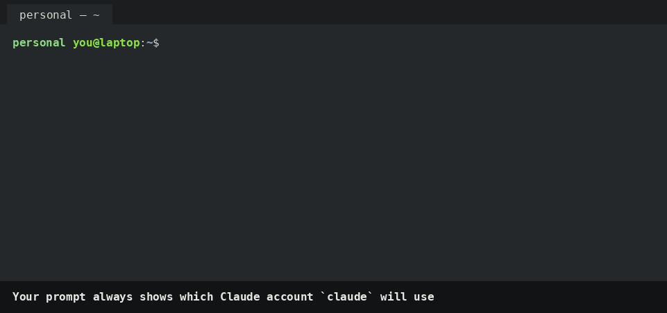

# Hats for Claude Code

**Wear the right Claude account for every project.**



Use several Claude accounts on one computer, such as personal, work and clients,
without logging out and back in. Your prompt always shows which account is active,
and each project folder uses the right one by itself.

```
personal you@laptop:~$ cd ~/code/acme
work you@laptop:~/code/acme$ claude        ← this runs on your work account
```

The name comes from "wearing many hats": one person, several roles. The command is `hat`.

---

## 1. Install

You need **Claude Code** and **Python 3.8 or newer**:
- **Linux, macOS:** Python is already there.
- **Windows:** install it with `winget install Python.Python.3.12`.

**macOS, Linux, WSL:**

```bash
git clone https://github.com/LukkaT/hats-for-claude-code.git
cd hats-for-claude-code
python3 install.py
```

**Windows (PowerShell):**

```powershell
git clone https://github.com/LukkaT/hats-for-claude-code.git
cd hats-for-claude-code
python install.py
```

Then **open a new terminal**. Your current Claude login is now the account called
`personal`, and you'll see `personal` at the start of your prompt.

## 2. Add your other account

Example: you also work for a company called Acme, with its own Claude account.

```bash
hat add work you@acme.com
hat login work
hat map work ~/code/acme
```

1. **`hat add work you@acme.com`** creates an account named `work`. Pick any name.
   The email is optional. If you give it, Hats refuses to use this account if it's
   ever signed in as someone else.
2. **`hat login work`** opens your browser to sign in to that account.
   If your browser is already signed in to claude.ai as another account, sign out
   there first, or paste the link into a private window.
3. **`hat map work ~/code/acme`** links a folder to the account. From now on, `claude`
   started in `~/code/acme`, or any folder inside it, uses `work`.

That's it. `cd ~/code/acme` and your prompt changes to `work`.

## 3. Everyday use

| You type | What happens |
| --- | --- |
| `claude` | Starts Claude on the account shown in your prompt. |
| `hat` or **F2** | Opens a menu to pick an account for this terminal window. |
| `hat use work` | Picks `work` for this terminal without the menu. The terminal stays on it in every folder; this is called **pinned**. |
| `hat auto` | Undoes a pin, so the folder decides again. |
| `hat status` | Lists your accounts: who is signed in, how much of the usage limits is used, and which folders belong to which account. |

## All commands

**Accounts**

| Command | What it does |
| --- | --- |
| `hat add <name> [email]` | Creates an account. Add `--separate` to keep its history and memory apart from the others (for clients who require that). |
| `hat login <name>` | Signs the account in through the browser. |
| `hat remove <name>` | Signs the account out and deletes it. Asks first. Your main login is never removed. |
| `hat default <name>` | Chooses the account used in folders that have no rule. At the start this is `personal`. |

**Folders**

| Command | What it does |
| --- | --- |
| `hat map <name> [folder]` | Links a folder (and everything inside it) to an account. Without a folder, it uses the one you're in. |
| `hat unmap [folder]` | Removes that link. |
| `hat which` | Shows which account applies in the current folder. |

**Running things**

| Command | What it does |
| --- | --- |
| `hat run <name>` | Starts Claude once on another account, without changing this terminal. |
| `hat code <name> [folder]` | Opens VS Code on an account, so its Claude extension uses it. Add `--editor cursor` or `--editor windsurf` for those editors. |
| `hat exec <name> <command>` | Starts any other program on an account. |

**Looking after it**

| Command | What it does |
| --- | --- |
| `hat doctor` | Checks that everything is set up correctly and explains how to fix anything that isn't. `hat doctor --fix` repairs what it can. |
| `hat update` | Downloads the latest version and installs it. |
| `hat export <file>` | Saves your accounts and folder links to a file, to set up another computer. It never contains logins. |
| `hat import <file>` | Loads such a file on the new computer. Then run `hat login` for each account. |
| `hat edit` | Opens the settings file in your editor. |
| `hat style clean`, `badge` or `minimal` | Changes how the account name looks in the prompt. |
| `hat status --json` | Status in a form scripts can read. |
| `hat version`, `hat help` | Shows the version, or a short list of commands. |

## Uninstall

Run this from the folder you downloaded (on Windows, `python` instead of `python3`):

```bash
python3 install.py --uninstall            # removes Hats, keeps your accounts
python3 install.py --uninstall --purge    # removes Hats and deletes the extra accounts
```

Your main Claude login is never touched. Terminals that are already open keep Hats
until you close them.

## Good to know

- **All accounts share** your settings, history and memory; only the login differs.
  So `claude --resume` works the same on every account. Use `--separate` when adding
  an account that must be kept apart.
- **Claude knows** which account it runs on: each session starts with a short note
  saying so.
- **Limits:** when an account has used 90% of its 5-hour or weekly limit, `claude`
  warns you before starting.
- **Platforms:** tested on Linux. macOS and Windows support is new; if something
  looks wrong, please [open an issue](https://github.com/LukkaT/hats-for-claude-code/issues).
- **Something wrong?** Run `hat doctor`, or see [Troubleshooting](docs/troubleshooting.md).

## Learn more

- [How it works](docs/how-it-works.md): the folders, what is shared, and exactly what the installer changes on your computer.
- [Troubleshooting](docs/troubleshooting.md): common problems and fixes.
- [Examples](examples/): a commented settings file and an export file.
- [Changelog](CHANGELOG.md): what changed in each version.
- [AGENTS.md](AGENTS.md): for developers and AI coding tools changing the code.
- [License](LICENSE): MIT.

To run the tests: `python3 -m unittest discover -s tests`.
