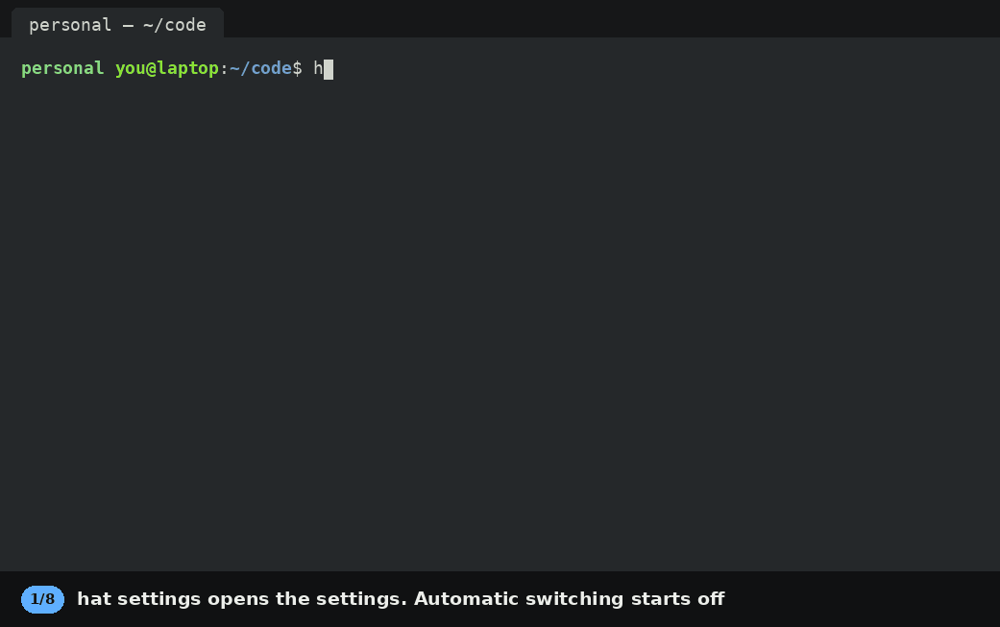

# Automatic switching

When an account runs low on its Claude usage limits, Hats can move your work to
another account, **only between the accounts you choose, in the order you choose,
and never without telling you.** It is off until you turn it on.



- [In one minute](#in-one-minute)
- [Setting it up](#setting-it-up)
- [The screen, line by line](#the-screen-line-by-line)
- [What "low" means, exactly](#what-low-means-exactly)
- [Which account takes over](#which-account-takes-over)
- [When it happens](#when-it-happens)
- [When it never happens](#when-it-never-happens)
- [What you see while it works](#what-you-see-while-it-works)
- [Work, client and personal accounts](#work-client-and-personal-accounts)
- [Without the screen](#without-the-screen)
- [Questions](#questions)

## In one minute

1. You put accounts in a list called **Take turns**, top first. Every other account
   stays under **Never switch to or from**, and Hats never moves work to or from it.
2. You choose when an account counts as **low**, for example *less than 10% left* of
   its 5-hour or weekly limit.
3. When you type `claude` and the account for this folder is low, Claude starts on
   the next account in Take turns instead, and Hats says so.
4. When an account gets low **during** a chat, Claude's status line says
   `/exit → continue on work`. After `/exit`, Hats asks
   `Continue this chat on 'work'? [Y/n]`. If you say yes, the same chat continues there.

Nothing changes in the middle of a reply. A chat only moves after you leave it and
say yes.

## Setting it up

Type `hat settings`. With your keyboard:

1. **Space** turns *Move to another account when one runs low* on.
2. **↓** to *Runs low = less than … left*, then **← →** to choose the level
   (5% to 50%, in steps of 5; 10% to start).
3. **↓** to an account under *Never switch to or from*. **Enter** picks it up (a ⇅
   appears), **↑** carries it into *Take turns*, **Enter** puts it down.
4. Do the same for the second account. The order matters: the higher one is used first.
5. Read the **Now:** line. It says in plain words what `claude` will do here.
6. **Esc** closes the screen. Every change is saved at once; there is no "save" step.

You need at least two accounts under Take turns. With one, there is nowhere to move to.

## The screen, line by line

```
 Hats · Settings                                   esc close

 ❯ Move to another account when one runs low     [ on ]
   Runs low = less than  10%  left of its 5-hour or weekly limit

   Take turns, top first                      left now
     1  personal                              58%
     2  work                                  97%

   Never switch to or from
        client-a

   Now: claude starts on personal. When it has less than 10%
   left, it moves on to work.

 space on/off · ←→ change · enter: pick up an account, ↑↓ move, enter drop
```

| Line | What it means |
| --- | --- |
| **Move to another account when one runs low `[ on ]`** | The main switch. `[ off ]`: nothing ever moves. Every folder keeps its own account, exactly as without this feature. Your list is kept, but greyed out and not used. |
| **Runs low = less than 10% left** | When an account counts as low. It looks at both limits: the 5-hour one and the weekly one. If **either** has less than this left, the account is low. |
| **Take turns, top first** | The accounts allowed to take over from each other. Number 1 is used first. |
| **left now** | How much is left of the account's **tighter** limit, the smaller of its 5-hour and weekly numbers. It shows *no usage yet* when Hats hasn't seen that account used yet ([why](#what-low-means-exactly)), and *not signed in, skipped* when it can't be used. |
| **Never switch to or from** | Accounts that are left out completely. Work never moves to them, and work started on them never moves away. |
| **Now:** | What `claude` will do in **this** terminal and folder, with the settings as they are on screen. It changes as you change things. |

**Keys**

| Key | Where | What it does |
| --- | --- | --- |
| ↑ ↓ | anywhere | Move the cursor (❯). |
| Space | the first line | Turn switching on or off. |
| ← → | the level | Less or more left before an account counts as low. |
| Enter | an account | Pick it up (⇅). Then ↑ ↓ carry it, even from one list into the other, and Enter puts it down. Esc puts it back where it was. |
| Space | an account | Shortcut: move it straight to the other list (to the bottom of Take turns, or out of it). |
| Esc or q | anywhere | Close. Changes are already saved. |

## What "low" means, exactly

- **Two limits.** Claude has a 5-hour limit and a weekly limit. An account is low when
  **either** has *less than* your level left. With 10%: 9% left is low, 10% is not.
- **Where the numbers come from.** Claude Code reports an account's limits while
  you use it, and Hats's status line writes them down. So Hats knows an account's
  numbers **from the last time Claude Code ran on it, on this computer.**
  - An account you haven't used here yet shows *no usage yet*, and counts as **having
    room**.
  - Use on claude.ai, the desktop app or another computer isn't seen until Claude
    Code runs on that account here again. An account can be lower than Hats thinks.
  - When a limit's reset time has passed, Hats counts it as full again, even before
    a new session reports the fresh number.
- `hat status` shows the same numbers, as *% left* and *when it resets*.

## Which account takes over

**The first account from the top of Take turns that isn't the one in use, is signed
in, and is not low.**

Example with Take turns: 1 `personal`, 2 `work`, 3 `client-b`

| In use | Situation | Takes over |
| --- | --- | --- |
| personal | personal is low; work has room | **work** |
| personal | personal and work are low | **client-b** |
| work | work is low; personal has room again | **personal** (it is higher in the list) |
| personal | work isn't signed in; client-b has room | **client-b** (work is skipped) |
| personal | everyone is low | **nobody**: Claude stays on personal, and Hats tells you |
| client-a | client-a is under *Never switch* | **nobody**: client-a never switches |

## When it happens

### When you start Claude

If the account for this folder (or the one you picked with `hat` / F2) is under Take
turns and low, Claude starts on the account that takes over:

```
personal you@laptop:~/code$ claude
hat: 'personal' has 6% left of its 5-hour limit (resets Thu 18:00) → starting on 'work' (automatic switching: hat settings)
```

This also applies to `claude -p "…"`, which uses the limits too. It does **not**
apply to commands that manage Claude itself (`claude auth …`, `claude mcp …`,
`claude config …`, `claude --version`), so `claude auth login` always signs in the
account shown in your prompt.

### During a chat

Claude Code can't change account in the middle of a chat, so Hats hands the chat over
between two runs of Claude:

1. While you work, Claude's status line shows the numbers. Once the account is low,
   it adds `/exit → continue on work`. This line only appears in a chat Hats is
   watching (see below).
2. You type `/exit` when it suits you, for example after the current reply. Nothing
   moves before that. If you keep going, Claude keeps using this account until its
   limit really runs out.
3. Hats asks: `Continue this chat on 'work'? [Y/n]`
   - **Enter** or **y**: Hats starts `claude --resume <this chat>` on `work`. The
     same conversation, with everything said so far, continues on the other account.
   - **n**: nothing happens. You stay in the terminal, and the chat is still on
     personal for later.
4. If work gets low later, the same thing happens again from work to the next account.

A chat can move because all accounts share their history (the `projects/` folder,
see [How it works](how-it-works.md#what-is-shared)). Two things don't carry over:

- **`--separate` accounts.** They keep their history to themselves, so a chat can't
  move to or from them. They can still take over when Claude **starts**.
- **Options you started Claude with** (such as `--model`). The continued chat starts
  with Claude's defaults.

**Watched chats.** For a chat on an account under Take turns, Hats stays running in
the background instead of handing over to Claude completely, so it can ask after
`/exit`. Ctrl-C still goes to Claude. Chats on other accounts, and everything when
switching is off, work exactly as before.

## When it never happens

- Switching is **off**.
- The account in use is under **Never switch to or from**.
- Fewer than two accounts take turns.
- `hat run <account>` and `hat exec <account> …`: you named the account yourself.
- `claude auth`, `claude mcp`, `claude config`, `claude --version` and similar.
- `claude` started from inside a Claude Code session keeps that session's account.
- Asking about a chat needs a terminal. In scripts, `claude -p` can switch at start,
  but nothing is ever asked.

## What you see while it works

- **Your prompt** keeps showing **this folder's account** (or the one you picked).
  That is the account `claude` *tries first*; it doesn't change when a chat moves.
- **Claude's status line** always shows the account Claude is **really** using.
  After a switch, that is where you'll see `work`.
- **The yellow `hat:` lines** say every time work moves, and why.
- **`hat status`** ends with a line such as
  `Automatic switching: on · moves on below 10% left · personal → work`.

## Work, client and personal accounts

Only put accounts under **Take turns** whose work is allowed to run on each other's
access. If an employer or client wants their work on their own account, leave that
account under **Never switch to or from**: their work stays on it even when it is low,
and other work never moves onto it.

## Without the screen

```bash
hat settings                          # the screen (in a script: prints it once)
hat settings switch on                # or: off
hat settings level 10                 # an account is low below 10% left (5 to 50)
hat settings order personal work      # who takes turns, top first; the rest never switch
hat settings order                    # nobody takes turns
```

They are stored in `~/.config/hats/hats.conf`:

```
switch on
switch_left 10
order personal work
```

`hat status --json` reports them as
`"switching": {"on": true, "left_below": 10, "order": ["personal", "work"]}`.

## Questions

**It didn't switch. Why?** Open `hat settings` and read the **Now:** line. Then check:

- Is it `[ on ]`?
- Is the account in use under **Take turns**? The prompt shows which one it is.
- Is it really low? Its **left now** may be old ([why](#what-low-means-exactly)).
- Does another account in Take turns have room and is it signed in?
- For a chat: did you leave with `/exit`, in a normal terminal?

**It says "no usage yet".** Hats hasn't seen that account used in Claude Code on this
computer. Start `claude` on it once (`hat run work`) and the numbers appear.

**Will it go back to my first account later?** Yes, for new chats. Once personal has
room again (for example after its 5-hour reset), the next `claude` starts on
personal again, because it is first in the list. A chat that moved to work stays on
work.

**Can I move a chat by hand, without waiting until an account is low?** Yes:
`hat run work --resume`, then pick the chat.

**How do I turn it off?** `hat settings`, then Space on the first line (or
`hat settings switch off`). Your list is kept for next time.
